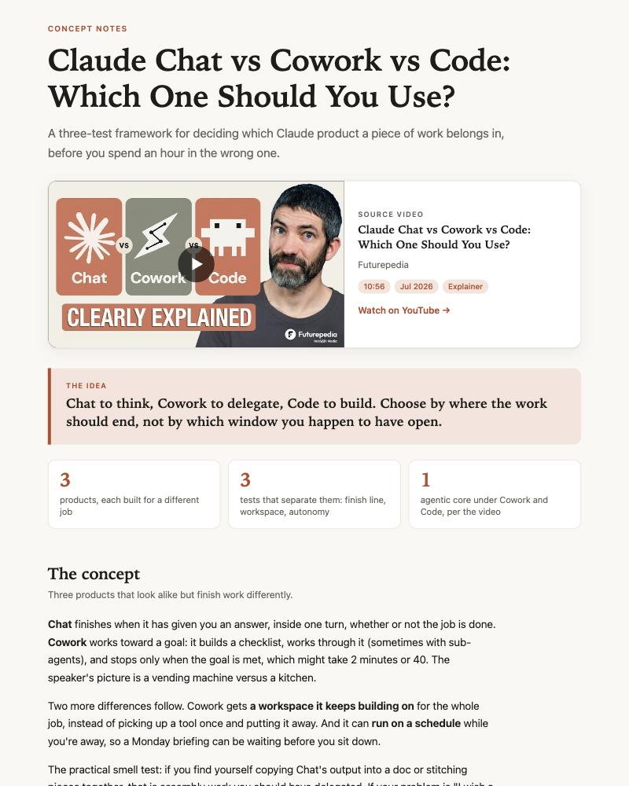

# claude-skills

Skills I've built with [Claude](https://claude.com) for [Claude Code](https://claude.com/claude-code) and Claude.ai. Each skill is a self-contained folder under `skills/` with a `SKILL.md` and any scripts it needs.

## Skills

| Skill | What it does |
|---|---|
| [learn-this](skills/learn-this) | Takes a YouTube link and turns what the video teaches into a visual HTML report: thumbnail, a diagram of the mechanism, stills from the video, and a ready-to-paste prompt for applying it. |

## Install

Copy a skill folder into your skills directory:

```bash
git clone https://github.com/aornelas/claude-skills.git
cp -R claude-skills/skills/learn-this ~/.claude/skills/
```

Or symlink it, so `git pull` is the only update step:

```bash
ln -s "$PWD/claude-skills/skills/learn-this" ~/.claude/skills/learn-this
```

## learn-this

Drop a YouTube URL into chat (or say "learn-this" with a link). The skill turns the video into a visual, self-contained HTML report:

1. Fetches the transcript with `scripts/get_transcript.py`, trying `youtube-transcript-api` and then `yt-dlp`. If YouTube blocks both (common from cloud IPs), it asks you to paste the transcript instead.
2. Pulls the video's thumbnail and details, and, when the video has slides, diagrams or demos, stills of the moments worth showing (`scripts/get_visuals.py`). Talking-head videos get no filler frames.
3. Identifies the underlying concept: the mechanism, why it works, what's actually new, and what has to be true for it to apply.
4. Writes the report: source card with the thumbnail, the core idea, a drawn diagram of the mechanism, the stills with deep links into the video, the application options that genuinely fit, and a self-contained prompt with a copy button. `scripts/finalize_report.py` inlines everything into a single `.html` file that opens anywhere and follows light or dark mode.

Requirements: Python 3, `ffmpeg`, and `pip install youtube-transcript-api yt-dlp` (if your `yt-dlp` is stale, the scripts fall back to `uvx yt-dlp`).



Example reports, each produced by running the skill on a real video. They are single self-contained files, so download one and open it in a browser:

- [Claude Chat vs Cowork vs Code](skills/learn-this/examples/claude-chat-vs-cowork-vs-code-concept-notes.html): a product explainer with slides, so it includes stills from the video.
- [How the Claude Code team uses Claude Code](skills/learn-this/examples/how-the-claude-code-team-uses-claude-code-concept-notes.html): a roundtable, so it relies on drawn diagrams.
- [Building secure agents for knowledge work](skills/learn-this/examples/building-secure-agents-for-knowledge-work-concept-notes.html): an interview, same approach.

The thumbnails and stills belong to the videos' owners and are included only as commentary on those videos.

## License

MIT. See [LICENSE](LICENSE).
